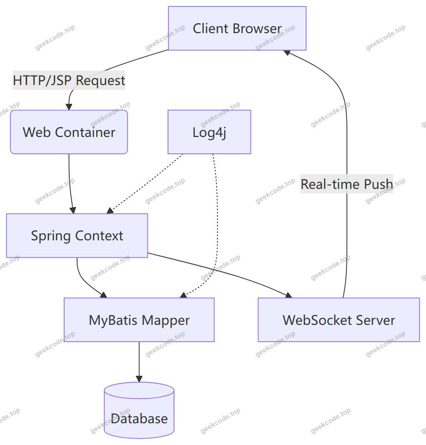
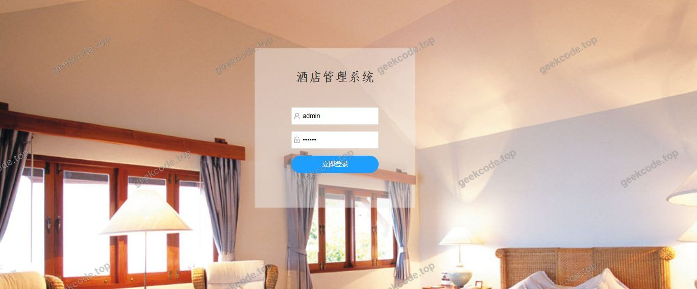
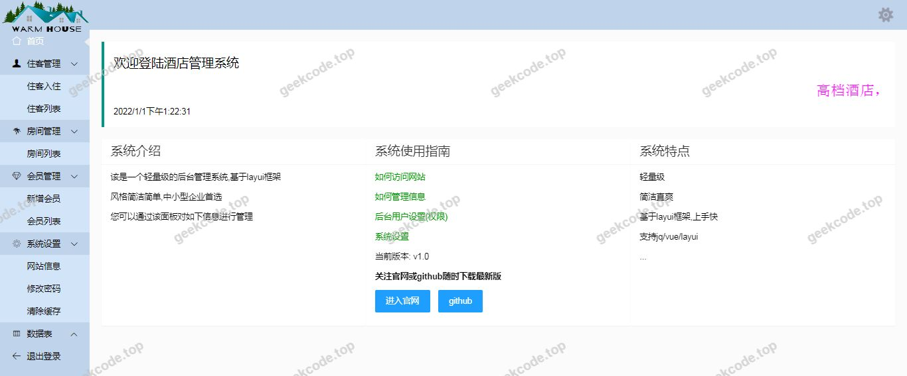
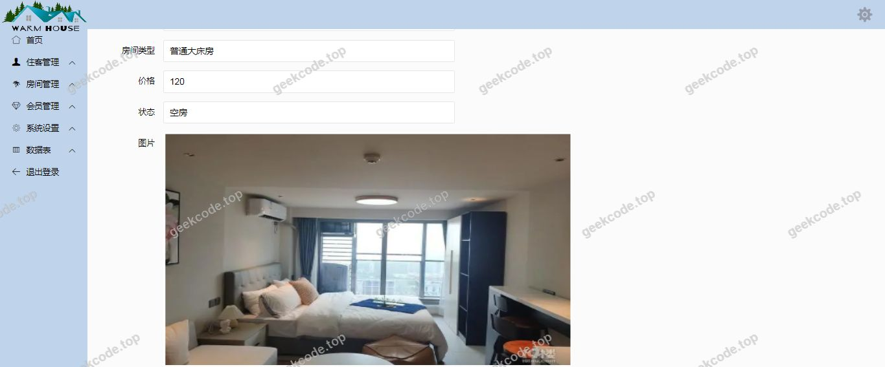
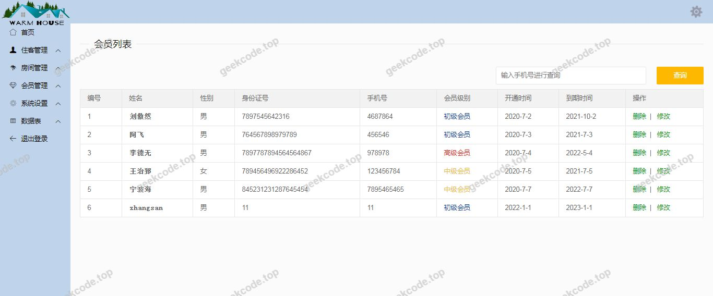
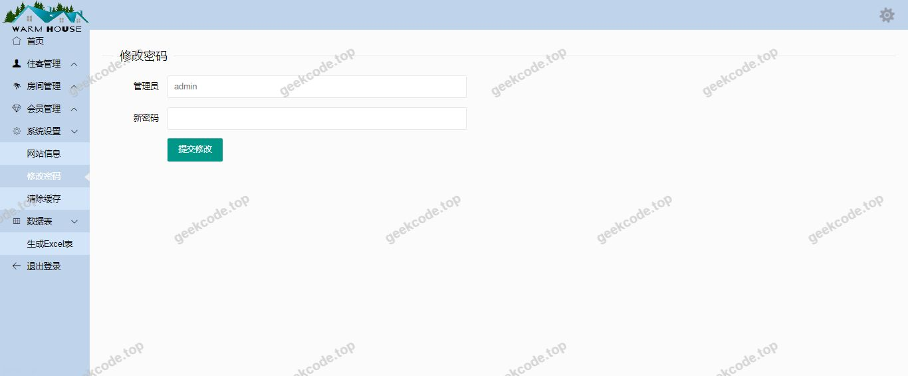

# java精品项目-酒店管理系统

> 🎓 **计算机毕业设计 · java精品项目-酒店管理系统**
>
> 本仓库只放**项目介绍 + 运行截图**（截图是站点带水印的原图，存在仓库 `images/` 里）。
>
> 👉 **完整可运行源码 / 数据库脚本 / 部署文档：[点我获取](https://geekcode.top/archives/java%E7%B2%BE%E5%93%81%E9%A1%B9%E7%9B%AE-%E9%85%92%E5%BA%97%E7%AE%A1%E7%90%86%E7%B3%BB%E7%BB%9F?utm_source=github)**
>
> 💬 咨询微信：**ir9372**　|　🌐 更多项目：[极客代码 geekcode.top](https://geekcode.top/?utm_source=github)
>
> 📌 项目详情页：<https://geekcode.top/archives/java%E7%B2%BE%E5%93%81%E9%A1%B9%E7%9B%AE-%E9%85%92%E5%BA%97%E7%AE%A1%E7%90%86%E7%B3%BB%E7%BB%9F?utm_source=github>

<table><td width="230" align="center"> <b>扫码加微信 ir9372</b></td><td valign="middle">📦 源码 = 项目介绍 + 全部运行截图 + 数据库 + 部署文档 👉 点上方任意截图，直接跳到 <b>极客代码 geekcode.top</b> 详情页</td></table>

---

<h1>java精品项目-酒店管理系统</h1>
<h2>项目概述</h2>

本项目为基于 Java 技术栈开发的酒店管理系统，旨在解决传统酒店人工管理效率低、信息易出错的问题。系统核心功能涵盖酒店业务的基础数据管理与实时交互，通过集成 MyBatis 进行持久层操作，并利用 WebSocket 实现前端与后端的高效通信。该项目主要面向酒店内部管理人员及前台接待人员，适用于中小型酒店的日常运营场景。技术架构采用经典的 MVC 模式，结合 Spring 框架生态与 JSP 视图技术，构建了一个稳定、可维护的管理平台，虽无独立的前台用户门户或复杂的后台路由配置，但聚焦于核心业务逻辑的处理与展示。

<h2>技术架构</h2>

系统后端基于 Spring Framework 生态构建，具体依赖包括 <code>spring-aop</code>、<code>spring-aspects</code>、<code>spring-beans</code>、<code>spring-context</code>、<code>spring-context-support</code>、<code>spring-expression</code>、<code>spring-instrument</code>、<code>spring-jdbc</code> 等模块，实现了控制反转（IoC）和面向切面编程（AOP）。持久层选用 MyBatis 框架，提供灵活的 SQL 映射能力，便于对酒店房间、订单等数据进行精细化操作。视图层采用 JSP 技术，直接嵌入 HTML 页面生成动态内容。通信层引入 WebSocket 技术，支持服务器主动推送消息至客户端，提升数据实时性。日志记录依赖 <code>log4j</code>，确保系统运行状态的可追溯性。整体架构轻量且耦合度适中，适合毕业设计级别的单体应用开发。

<h2>功能模块</h2>

根据提供的截图列表（系统运行界面1-5），系统主要呈现为单一的操作界面集合，未明确区分复杂的前台用户端与后台管理端菜单结构。现有信息表明系统具备以下基础功能特征：

<ol>
<li><strong>核心业务操作界面</strong>：包含五个主要运行界面，推测分别对应酒店管理的不同业务环节，如入住登记、退房结算、房态查询、订单管理及基础设置。由于缺乏具体的菜单定义，无法详细拆解每个界面的子功能。</li>
<li><strong>实时数据交互模块</strong>：依托 WebSocket 技术，系统可能具备房态实时更新或通知推送功能，确保管理员能即时获取最新业务状态。</li>
<li><strong>数据持久化模块</strong>：通过 MyBatis 实现对酒店相关数据的增删改查操作，支撑上述界面的数据展示与提交。</li>
</ol>

<em>注：根据现有信息无法确定是否存在独立的“前台用户端”或更细粒度的“后台管理端”功能划分，所有功能均体现于上述系统运行界面中。</em>

<h2>用户角色与权限</h2>

根据项目描述中“是否有前台: 否”、“是否有后台: 否”以及无导航菜单、无路由配置的信息，本系统在代码层面未实现基于角色的访问控制（RBAC）或多用户登录体系。

<ol>
<li><strong>默认使用者</strong>：系统假设由单一类型的操作人员使用，即酒店工作人员。</li>
<li><strong>权限模型</strong>：不存在“管理员”、“普通用户”等多级角色区分。所有访问系统的人员拥有相同的操作权限，可直接访问全部五个系统运行界面。</li>
<li><strong>身份验证</strong>：现有信息未提及登录模块或认证机制，因此无法确定是否具备用户身份识别功能。</li>
</ol>
<h2>项目特色与创新点</h2>
<ol>
<li><strong>实时通信技术应用</strong>：在传统 JSP/Servlet 架构中引入 WebSocket，突破了 HTTP 请求响应模式的限制，使得酒店房态变化、紧急通知等信息能够以毫秒级延迟推送到客户端，提升了管理系统的响应速度和用户体验。</li>
<li><strong>轻量化技术选型</strong>：摒弃了复杂的微服务或大型前端框架（如 Vue/React），选择 Spring + MyBatis + JSP 的经典组合，降低了系统复杂度，更适合专注于业务逻辑本身的教学与实践目的，体现了对底层原理的深入理解。</li>
<li><strong>专注核心业务闭环</strong>：虽然界面数量精简（仅5个核心界面），但覆盖了酒店管理最关键的流程，避免了功能冗余，强调了从数据录入到实时展示的完整闭环能力。</li>
</ol>
<h2>部署环境</h2>

为确保系统正常运行，需准备以下软件环境：

<ol>
<li><strong>JDK</strong>：建议版本 JDK 1.8 或以上，用于编译和运行 Java 代码。</li>
<li><strong>Web 容器</strong>：Tomcat 8.5 或更高版本，用于部署 JSP 页面并处理 HTTP/WebSocket 请求。</li>
<li><strong>数据库</strong>：MySQL 5.7 或 MySQL 8.0，用于存储酒店业务数据。</li>
<li><strong>构建工具</strong>：Maven 3.x，用于管理项目依赖（如 log4j, spring-* 系列包, mybatis 等）。</li>
<li><strong>浏览器</strong>：Chrome、Edge 或 Firefox 等现代浏览器，需支持 WebSocket 协议。</li>
</ol>
<h2>五、技术特性</h2>
<ul>
<li>服务端模板渲染（JSP）</li>
</ul>
<h2>六、功能模块截图</h2>
<h3>前台用户端</h3>
<h4>系统运行界面1</h4>

<h4>系统运行界面2</h4>

<h4>系统运行界面3</h4>

<h4>系统运行界面4</h4>

<h4>系统运行界面5</h4>

---

## 获取完整源码

| 项目 | 说明 |
| --- | --- |
| 项目名 | java精品项目-酒店管理系统 |
| 运行截图 | 本文 6 张（站点带水印原图，仓库 `images/` 目录） |
| 完整源码 | [https://geekcode.top/archives/java%E7%B2%BE%E5%93%81%E9%A1%B9%E7%9B%AE-%E9%85%92%E5%BA%97%E7%AE%A1%E7%90%86%E7%B3%BB%E7%BB%9F?utm_source=github](https://geekcode.top/archives/java%E7%B2%BE%E5%93%81%E9%A1%B9%E7%9B%AE-%E9%85%92%E5%BA%97%E7%AE%A1%E7%90%86%E7%B3%BB%E7%BB%9F?utm_source=github) |
| 咨询微信 | **ir9372**（备注：jingpin-yuanma） |
| 更多项目 | [极客代码 geekcode.top](https://geekcode.top/?utm_source=github) |

> 需要源码、部署、改配置、跑不起来等问题，加微信 ir9372 沟通，说明项目名即可。
